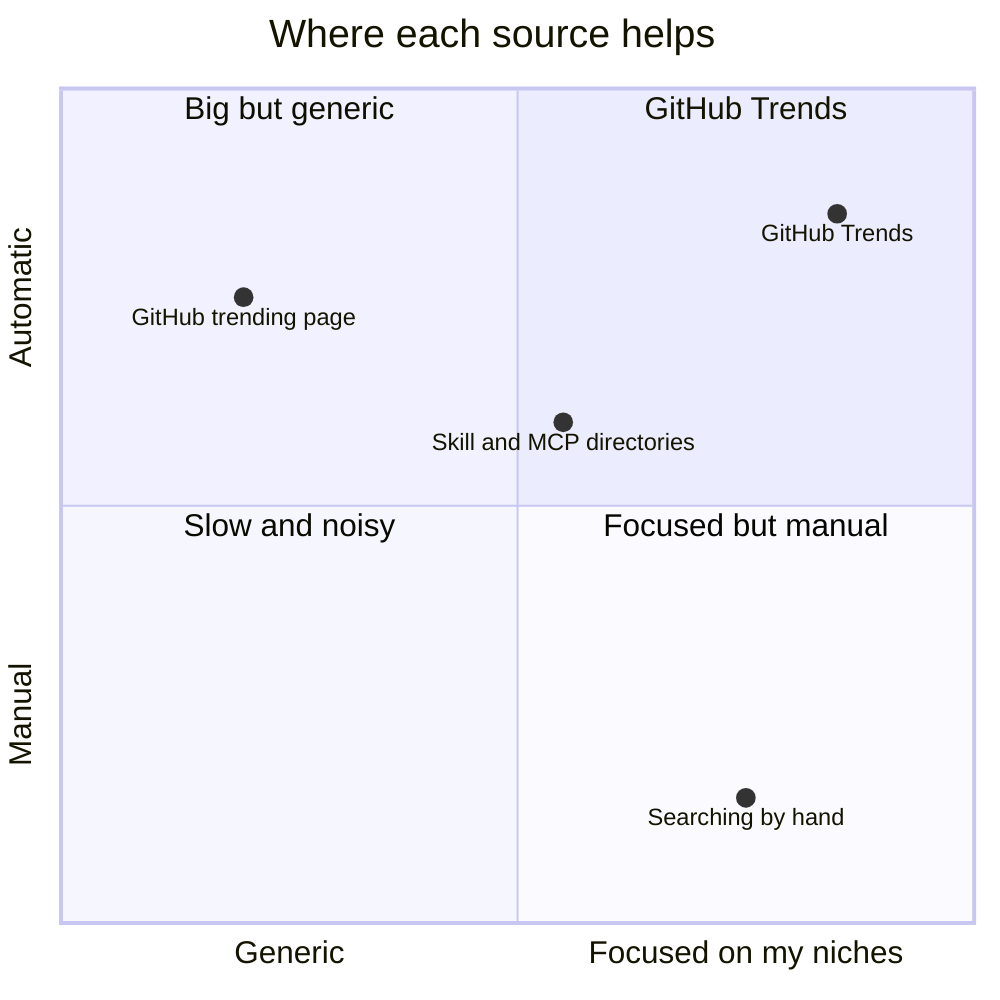
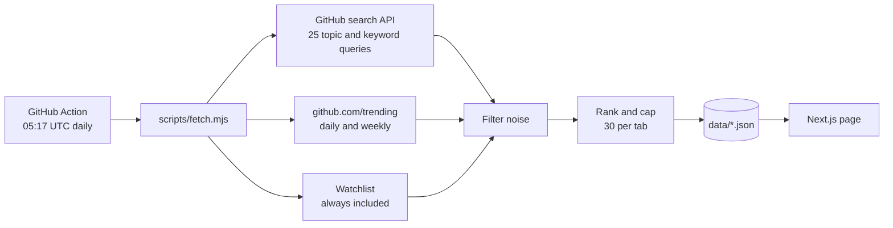
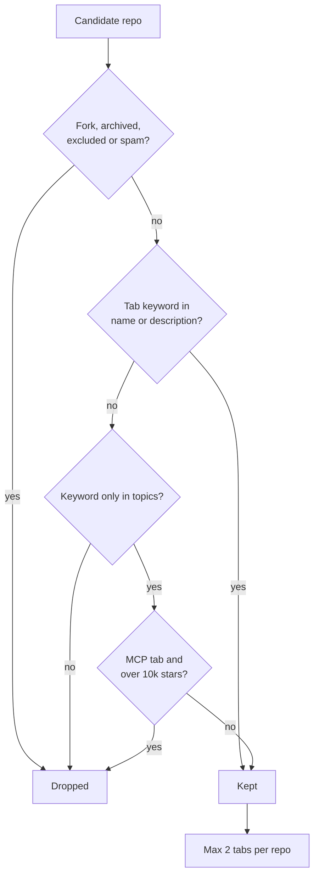
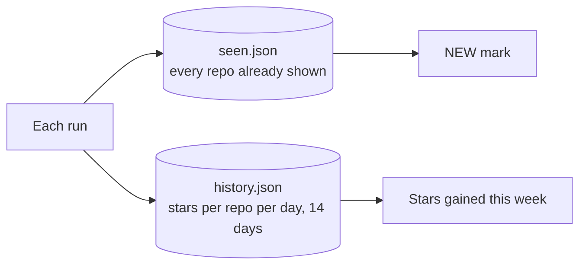
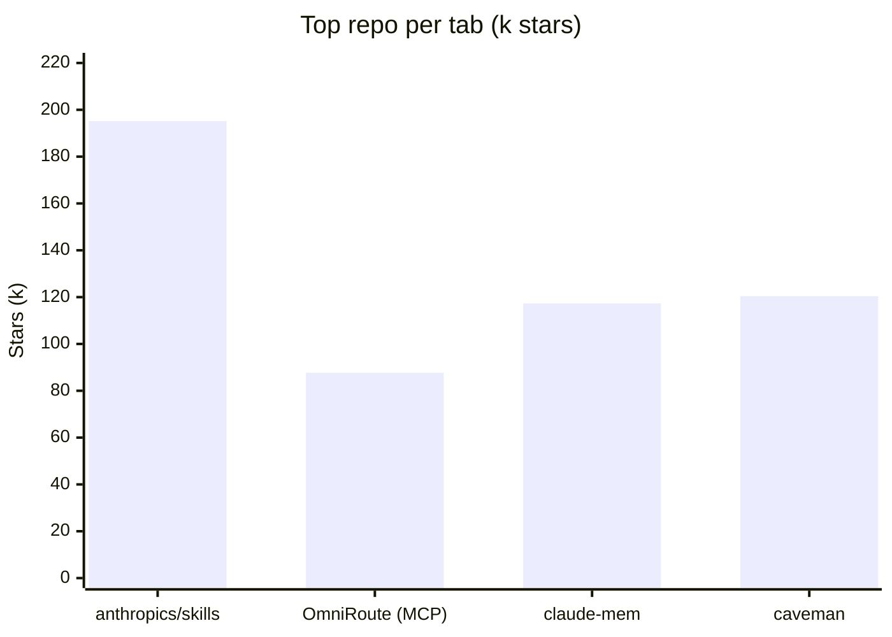
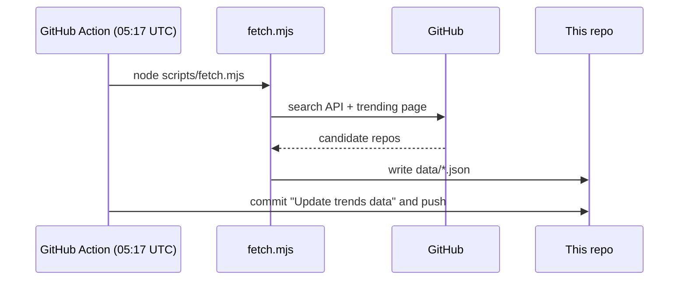

# GitHub Trends

A small page that tracks the rising GitHub repos that make AI agents better: **Claude skills**, **MCP servers**, **memory & context** tools and **agent tooling** (token savers, gateways, code intelligence). It refreshes itself every morning.


## Why

GitHub's trending page shows the top 25 repos across *everything*. Niche agent tools rarely make that list, and directories don't know which niches you care about. Finding them meant searching by hand every day.



## Features

- **Four tabs**: Skills, MCP, Memory & Context, Agent tooling (30 repos each, plus watched repos)
- **Stars gained** today or this week, from the trending page or from daily star history
- **NEW** mark for repos never shown before, with a "New only" filter
- **WATCHED** mark for repos on your watchlist, which are always shown
- **Copy-ready install commands** (`npx skills add owner/repo`) for skills
- **Search** across names, descriptions and topics
- **Monochrome UI** with system, light and dark themes, safe-area padding for phones and accessible ui-sdk components

## How it works

Every morning a GitHub Action runs one dependency-free script, commits the new data, and the page reads it.



### 1. Collect

| Source | What it adds |
|---|---|
| **Search API** | 25 queries (topics like `claude-skills`, `mcp-server`, `agent-memory`, `token-optimization`), each run twice: repos **pushed in the last 7 days** and repos **created in the last 30 days**. 100 results per query. |
| **Trending page** | Repos on github.com/trending (daily and weekly) that match a tab, with their stars gained. |
| **Watchlist** | Repos you never want to miss, fetched directly every run. |

### 2. Filter

A repo only lands in a tab if it passes every step:



- **Keywords** are regexes per tab, for example `token (saving|compression|cost)`, `ai gateway` or `codebase index` for Agent tooling.
- **Exclude list**: big generic platforms (n8n, dify, open-webui and others) that tag themselves `mcp` or `memory` but are not agent tooling.
- **Topic-only limit**: in the MCP tab, a repo over 10k stars that only *tags* itself `mcp` is skipped.

### 3. Rank

1. Repos with a star gain first, biggest gain on top.
2. Then by total stars.
3. Up to **8 of the 30 slots** are kept for repos created in the last 30 days, so new projects are not buried under giants.
4. Watched repos are added on top of the 30.

### 4. Remember



- **NEW** = not in `seen.json` before this run. The very first run marks nothing as new.
- **Stars gained this week** = stars now minus the oldest snapshot from the last 7 days (at least 1 day old). Trending-page numbers win when present.

## Day one snapshot

Biggest repo in each tab (thousands of stars):



| Tab | What goes in it | Examples |
|---|---|---|
| Skills | Claude and agent skills | anthropics/skills, addyosmani/agent-skills |
| MCP | Model Context Protocol servers | upstash/context7, chrome-devtools-mcp |
| Memory & Context | Long-term memory for agents | MemPalace/mempalace, claude-mem, cognee |
| Agent tooling | Token savers, gateways, code intelligence | JuliusBrussee/caveman, rtk, headroom |

## Run it locally

Needs Node 22.

```bash
npm install
npm run fetch   # collect fresh repos into data/ (about 2.5 min)
npm run dev     # http://localhost:3000
```

The fetch uses `GITHUB_TOKEN` if set, otherwise your `gh auth token`, otherwise runs unauthenticated (slower: about 6.5 s between searches instead of 2.2 s). Reload the page after a fetch; no rebuild needed.

| Command | What it does |
|---|---|
| `npm run dev` | Start the dev server |
| `npm run fetch` | Refresh the data |
| `npm test` | Run the tests (Vitest, 41 tests) |
| `npm run lint` | Lint |
| `npm run build` | Production build |

## Make it yours

Everything you would want to change is at the top of [`scripts/fetch.mjs`](scripts/fetch.mjs):

| Constant | Change it to |
|---|---|
| `WATCH` | Add repos you always want to see, mapped to a tab |
| `QUERIES` | Add or remove GitHub search queries per tab |
| `KEYWORDS` | Tune what counts as relevant for each tab |
| `EXCLUDE` | Hide repos that keep showing up but don't belong |
| `CAP` / `FRESH` | Repos per tab / slots kept for brand-new repos |

To add a whole new tab, add a key to `QUERIES` and `KEYWORDS`, then add it to `CATEGORIES` in [`components/repos.ts`](components/repos.ts).

## Automation



| Workflow | When | What |
|---|---|---|
| [`fetch.yml`](.github/workflows/fetch.yml) | Daily at 05:17 UTC, or by hand from the Actions tab | Runs the fetch with the built-in `GITHUB_TOKEN` and commits the new data. No secrets to set up. |
| [`ci.yml`](.github/workflows/ci.yml) | Every push and pull request | Lint, tests and build |

## Project structure

```
scripts/fetch.mjs       the whole data pipeline, no dependencies
data/repos.json         what the page shows
data/seen.json          repos already shown (NEW mark)
data/history.json       daily star snapshots (weekly gains)
app/                    Next.js layout, page and monochrome styles
components/             board, tabs, repo rows, theme control, data loading
tests/                  Vitest + Testing Library
.github/workflows/      daily fetch and CI
```

## Built with

- [Next.js](https://nextjs.org) 16 and React 19
- [ui-sdk](https://ui-sdk.dev) for accessible tabs, switch, segmented control, input and buttons
- Tailwind CSS 4
- Plain Node for the fetch script

## Kept small on purpose

- **No database, no server, no accounts.** One script, three JSON files, one page.
- **No dependencies** in the fetch script.
- **Free to run**: about 2.5 minutes a day on GitHub Actions.
